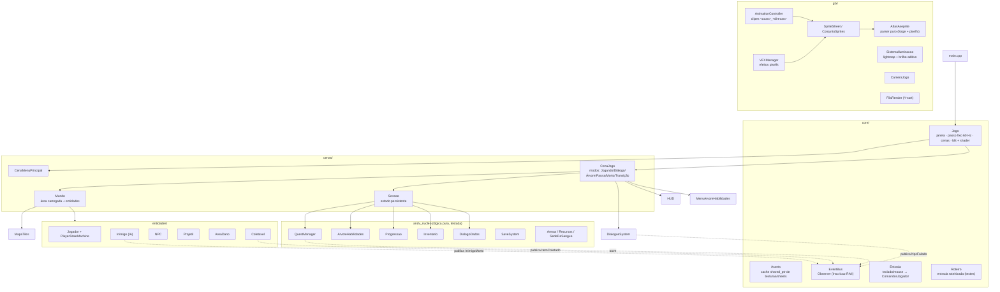

# Arquitetura — Andvarion

C++17 + raylib 5.0, alvo **x86 (32 bits)**. Tela virtual 640×360 ampliada por fator inteiro.

## Escala (`core/Escala.hpp`)
| Grandeza | Valor |
|---|---|
| Lógica do jogo | unidades de mundo; 1 tile = 16 unidades |
| Câmera do mundo | zoom 2 → 1 unidade = 2 px de tela |
| Arte | resolução dobrada: tiles de 32 px (`tamanhoTileArte`), personagens ~55 px em quadros 48×64, âncora (24, 62) |
| Pintura | `ESCALA_DESENHO = 0,5` → 1 px de arte = 1 px de tela; posições em `snapTela` |

Velocidades, alcances, luzes e mapas não mudaram com o aumento de proporção.

## Paper-doll e equipamento
```
Sessao.equipamento (slots → ids de item)      itens.json: slot, arma, atributos, visual
          │                                              │
          └──────► Jogador::aplicarEquipamento ◄─────────┘
                     ├─ arma/distância ativas (tabela Armas)
                     ├─ atributos (defesa, vida, mana, velocidade, magia)
                     └─ PaperDoll: Capa · Corpo · Armadura · Escudo · Arma
                                   (o corpo anima; as camadas copiam clipe + índice)
```
* A ordem de pintura muda com a direção (`PaperDoll::ordem`): de costas a capa vai por cima e a arma por baixo; de perfil o escudo fica atrás do corpo.
* A camada da arma mostra a arma à distância enquanto o herói mira e logo após o disparo.
* Afterimages da esquiva congelam todas as camadas.
* `ui/MenuInventario` (tecla I): abas, lista, slots e prévia animada; equipar chama `aplicarEquipamento` na hora.

## Visão geral dos módulos



A biblioteca `andv_nucleo` não inclui a raylib: missões, diálogos, progressão,
árvore, inventário, save e o parser de atlas compilam e são testados sem janela
(`tests/testes.cpp`).

## Grimório, árvore literal e proficiência
```
arvore_habilidades.json ─ galhos (ramo, escola, ângulo, comprimento) ─ nós (galho, ordem, efeito)
        │                                         requisito implícito: nó anterior do galho
        ▼
ArvoreHabilidades ── feiticoLiberado(id) ──► Sessao::organizarGrimorio ──► grimorio[4] (1, 2, 3, Q)
        │ bonus("<magia>.<atributo>")                                         │
        ▼                                                                     ▼
Jogador::lancarFeitico(id)  ◄── EstadoConjurando(slot) ◄── tecla ── Jogador::feiticoNoSlot(slot)
        │ dano × (magia + proficiência da escola) × (1 + melhorias do galho)
        │ custo × (1 − desconto da escola);  recarga por magia
        └─► Proficiencia::ganhar(escola, 3)   golpes/projéteis: ganhar(arma, acertos)
```
* Magias que criam entidades: `Projetil` (Bola de Fogo, Lança de Gelo com lentidão), `AreaDano` (Névoa, Correntes), `Familiar` (orbita e atira). Efeitos no jogador: Escudo Arcano (absorve antes da defesa) e Encantamento de Lâmina (multiplica o dano corpo a corpo).
* `Combatente::lentidao`: inimigos andam a 45% e ficam azulados.

## Laço principal

```
Jogo::executar()
 ├─ Roteiro::avancar (se ANDV_ROTEIRO)
 ├─ Cena::lerEntrada()            1x por quadro de render (acumula bordas)
 ├─ while (acumulado >= 1/60)
 │    Cena::atualizar(1/60)       passo fixo; bordas valem só no 1º passo
 ├─ Cena::prepararQuadro()        render targets próprios (lightmap)
 ├─ BeginTextureMode(tela 480x270) → Cena::desenhar()
 └─ blit com escala inteira + shader assets/shaders/atmosfera.fs
```

Render targets da raylib **não aninham**: `EndTextureMode` volta ao framebuffer
padrão. Por isso o lightmap é montado em `prepararQuadro`, antes da tela virtual.

## Render de uma área (CenaJogo::desenhar)

1. `SistemaIluminacao::renderizar` (em `prepararQuadro`): lightmap limpo com a cor do ambiente (azul-noite, alfa = escuridão); cada luz subtrai escuridão com `dst = dst·(1−src.a)`.
2. `MapaTiles::desenharChao` (chão + paredes) e VFX da camada `Chao`.
3. **Y-sort** (`FilaRender`): tiles de decoração altos, NPCs, inimigos, projéteis, itens e o jogador (com afterimages) ordenados pelo Y dos pés.
4. VFX da camada `Frente`.
5. `SistemaIluminacao::aplicar`: lightmap por cima + brilho aditivo colorido (lanterna quente, tochas oscilantes, flashes de magia).
6. UI: HUD, rastreador de missões, notificações, diálogo, menus, fade.

## Ciclo de Sinergia Sangue-Arcano (PlayerStateMachine)

```mermaid
stateDiagram-v2
    [*] --> Ocioso
    Ocioso --> Movendo: WASD
    Movendo --> Ocioso: solta
    Ocioso --> AtaqueLamina: LMB
    Movendo --> AtaqueLamina: LMB
    AtaqueLamina --> AtaqueLamina: LMB no buffer (golpe 1→2→3)
    AtaqueLamina --> Ocioso: fim (janela de combo aberta)
    Ocioso --> Mirando: RMB
    Movendo --> Mirando: RMB
    Mirando --> Ocioso: solta RMB (dispara; carga cheia = perfurante)
    Ocioso --> Conjurando: 1/2/3/Q
    Movendo --> Conjurando: 1/2/3/Q
    AtaqueLamina --> Conjurando: na recuperação
    Conjurando --> Ocioso: lança (ativa Sede de Sangue)
    Ocioso --> Esquiva: Espaço/Shift
    AtaqueLamina --> Esquiva: na recuperação
    Mirando --> Esquiva
    Esquiva --> Ocioso: 0,22 s (i-frames)
    Ocioso --> Atordoado: dano
    Atordoado --> Ocioso
    Atordoado --> Esquiva: fim do atordoamento
    Ocioso --> Morto: vida 0
```



* **Lâmina** (`EstadoAtaqueLamina`): o acerto acontece no evento `hit` do clipe da forge, ou na `fracaoAtivo` da arma. Cada acerto chama `Recurso::ganhar` na mana (essência drenada).
* **Magia** (`EstadoConjurando` → `Jogador::lancarFeitico`): gasta mana e chama `SedeDeSangue::ativar`.
* **Sede de Sangue**: o próximo golpe ou disparo lê `multiplicadorVelocidade()` e depois `consumir()` (multiplicador de dano). Um disparo só consome a carga se realmente sair.
* **Distância** (`EstadoMirando`): segurar carrega; com a carga cheia o projétil fica `perfurante` (bumerangue: volta ao jogador).
* **Hit-stop**: `Mundo::hitStop` congela a simulação; luzes, VFX e tremor de câmera continuam. O tempo vem do `act.hits[].freeze` do efeito do pixelfx.

Os estados são classes (`std::unique_ptr<EstadoJogador>`); a troca fica pendente
e é aplicada no fim do update. Dano externo usa `aplicarPendente` na hora.

## Observer: missões e eventos

```
Inimigo::morrer ──publica InimigoMorto("cultista")──┐
Coletavel       ──publica ItemColetado("erva")──────┤
DialogueSystem  ──publica NpcFalado("curandeira")───┼──► EventBus ──► QuestManager (só missões ATIVAS)
                                                    │                    └─publica MissaoAtualizada / ProntaParaEntregar / Concluida
                                                    │                               │
                                                    └──────────────────────────────►├──► Notificacoes (avisos na tela)
                                                                                    └──► CenaJogo::entregarRecompensa (XP, itens, bônus, autosave)
```

`EventBus::publicar` enfileira eventos publicados durante uma entrega (sem
recursão). `Inscricao` é RAII: destruir o observador cancela a inscrição.

## Formatos de dados (`assets/`)

| Arquivo | Conteúdo |
|---|---|
| `mapas/<area>.json` | `linhas` (matriz de caracteres) + `legenda` (`chao`, `parede`, `decoracao`, `alto`), `solidos`, `ambiente` RGBA, `objetos` em coordenadas de tile (`spawn`, `tocha`, `braseiro`, `luz`, `npc`, `inimigo` + `patrulha`, `item` + `uid`, `transicao`, `vfx`). Também aceita `camadas` numéricas inline ou em CSV (ex.: exportadas do Tiled). |
| `dados/missoes.json` | missões: `objetivos` (`MATAR_INIMIGO` / `COLETAR_ITEM` / `FALAR_NPC`), `doador`, `entregarPara`, `requisito`, `recompensa` (`xp`, `itens`, `bonus`). |
| `dados/dialogos.json` | por NPC: `entradas` condicionais → `nos` (texto, `opcoes`, `acoes`, `proximo`). Condições: `missao:<id>:<ESTADO>`, `pode_aceitar:<id>`, `item:<id>:<qtd>`, `objetivo:<id>:<i>:completo`, com prefixo `!` para negar. Ações: `aceitar:<id>`, `entregar:<id>`, `curar`, `salvar`. O carregador recusa referências quebradas. |
| `dados/arvore_habilidades.json` | nós: `ramo`, `coluna`/`linha`, `custo` (0 = inicial), `nivelMinimo`, `requisitos`, `efeito` (`feitico` / `atributo` / `passiva`). |
| `dados/itens.json` | nomes PT-BR e VFX de cada item. |
| `vfx/indice.json` + `vfx/<chave>.{png,json}` | gerados pelo pixelfx (`tools/gerar_vfx.mjs`). |
| `sprites/<personagem>/*.json` | atlas Aseprite do agent-sprite-forge (uma página por JSON). |
| `saves/save1.json` (ao lado do executável) | `SaveData`: área, posição, nível, XP, habilidades, inventário, missões com progresso, itens únicos coletados. Gravação atômica. |

## Regras de 32 bits

* `CMakeLists.txt` chama `andv_exigir_32_bits()`, que para a configuração se `CMAKE_SIZEOF_VOID_P != 4`.
* `andv_aplicar_alvo()` adiciona `-m32` (GCC/Clang) ou `/MACHINE:X86` (MSVC) e define `ANDV_ALVO_32_BITS`.
* `include/andvarion/core/Plataforma.hpp` faz `static_assert(sizeof(void*) == 4)`.
* Dados persistidos usam `int32`/`float`; nada de `size_t`/`long` em disco.
* raylib e nlohmann_json entram por `FetchContent` no mesmo build, herdando as flags de 32 bits do toolchain.
